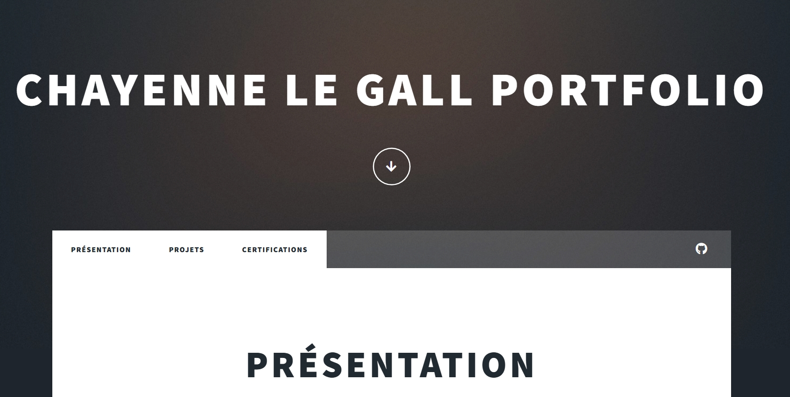

# Portfolio Personnel

## Description

Le portfolio que vous consulté actuellement est également l'un de mes projets, développé à l'aide d'une template HTML, Visual Studio Code et GitHub. Il me permet de présenter mes projets, mes certifications, mes compétences et mon parcours.

## Aperçu 

## Fonctionnalités et contenus

- Présentation personnelle
- Galerie de projets
- Page dédiée aux certifications
- Lien ver github
- Navigation entre les différentes pages

## Objectifs du projet

- Découvrir le développement web
- Créer une vitrine professionnelle de mes projets

## Auteur

Chayenne Le Gall
